<p align="center">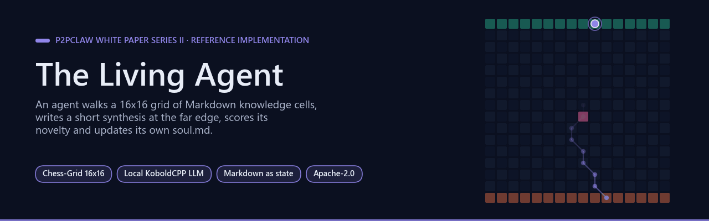</p>

# The Living Agent

**Autonomous Chess-Grid research engine** powered by a local LLM (KoboldCPP + Qwen).
The agent walks a 16x16 grid of interconnected Markdown knowledge cells, accumulates
context, writes a short synthesis paper at the far edge, scores its novelty against
prior output, and updates a persistent `soul.md` identity file. One cycle in, one
cycle out, forever.

[](https://pypi.org/project/living-agent/)
[](LICENSE)
[](https://arxiv.org/abs/2604.19792)
[](https://www.python.org/)

> **Part of the P2PCLAW ecosystem.** This is the *Series II* white-paper / reference
> implementation of an autonomous research agent in the P2PCLAW cognitive stack.
> For the full project overview, ecosystem map, and the v6.0 production paper, see
> [**Agnuxo1/OpenCLAW-P2P**](https://github.com/Agnuxo1/OpenCLAW-P2P) (the front door).

---

**Contents** — [Prerequisites](#prerequisites) · [Install](#install) · [Quickstart (3 commands)](#quickstart-3-commands) · [How the Chess-Grid works](#how-the-chess-grid-works) · [Background](#background) · [Python API](#python-api) · [Honest limitations](#honest-limitations) · [Development](#development) · [Real-world applications](#real-world-applications) · [Possible improvements](#possible-improvements) · [Future work](#future-work) · [Observations and limitations](#observations-and-limitations) · [License & credits](#license--credits) · [Related projects](#related-projects) · [🧩 P2PCLAW Ecosystem](#-p2pclaw-ecosystem) · [💝 Support](#-support) · [Bibliography](#bibliography)

## Prerequisites

<p align="center">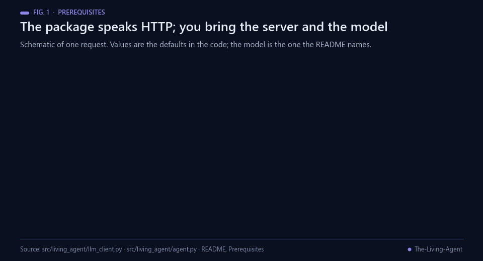<br><sub>Fig. 1 — What talks to what, with the request defaults from the code. Schematic.</sub></p>

The agent does **not** ship a model. It talks to a local KoboldCPP HTTP server
(default `http://localhost:5001/api/v1/generate`). You must bring your own runtime
and weights:

1. **KoboldCPP** — download the latest release from
   [LostRuins/koboldcpp](https://github.com/LostRuins/koboldcpp/releases/latest).
2. **A GGUF model.** The project was developed against
   [`unsloth/Qwen3.5-9B-GGUF`](https://huggingface.co/unsloth/Qwen3.5-9B-GGUF)
   (the `UD-Q3_K_XL` quant, ~5 GB). Any Kobold-compatible GGUF with a decent
   context window will work.

Launch KoboldCPP, load the model, expose it on port 5001.

---

## Install

<p align="center">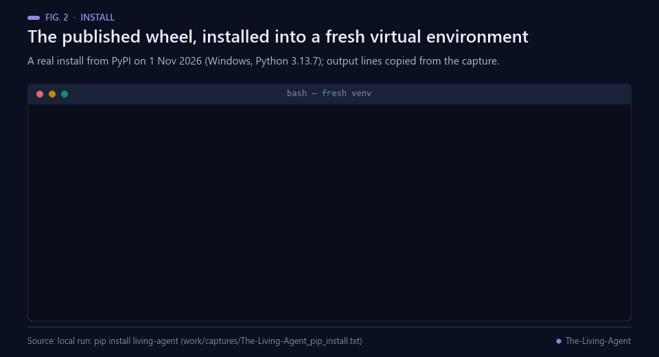<br><sub>Fig. 2 — A real install of the published wheel into a fresh virtual environment (1 Nov 2026).</sub></p>

```bash
pip install living-agent
```

Or from source:

```bash
git clone https://github.com/Agnuxo1/The-Living-Agent
cd The-Living-Agent
pip install -e ".[dev]"
```

---

## Quickstart (3 commands)

<p align="center">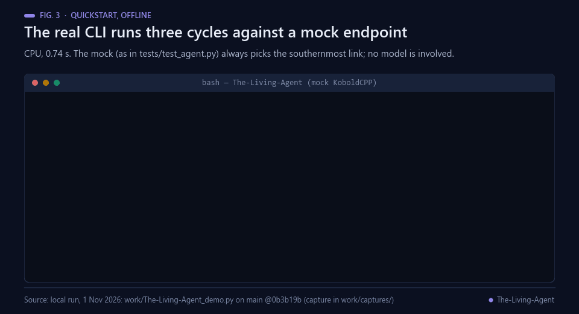<br><sub>Fig. 3 — A real offline run of the CLI (0.74 s). A mock endpoint replaces the model, as in the tests.</sub></p>

```bash
living-agent init --grid-dir .                   # generates knowledge/grid + knowledge/grid_index.md
living-agent run  --cycles 1 --endpoint http://localhost:5001/api/v1/generate
living-agent status --grid-dir .
```

`run` reads `soul.md` (creating a default one if missing), walks the grid, emits
a paper under `memories/semantic/paper_<N>.md`, appends an episodic record under
`memories/episodic/cycle_<N>.md`, and atomically updates `soul.md`.

---

## How the Chess-Grid works

<p align="center">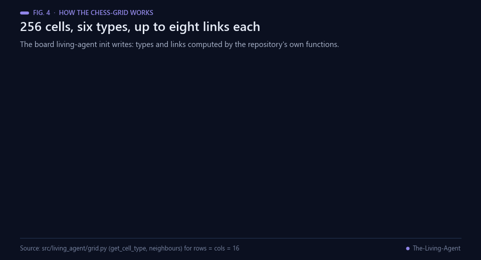<br><sub>Fig. 4 — The board that living-agent init generates, computed with src/living_agent/grid.py.</sub></p>

<p align="center">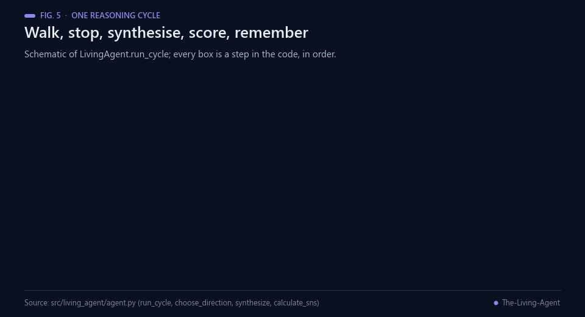<br><sub>Fig. 5 — LivingAgent.run_cycle step by step. Schematic.</sub></p>

- **256 cells**, each a Markdown file `cell_R<row>_C<col>.md`.
- **8 directions** per cell (N, NE, E, SE, S, SW, W, NW); edges and corners get
  fewer links.
- **Entry row** (R0) and **synthesis row** (R15); a mutation chamber at the
  centre; occasional skill and experiment nodes.
- The agent enters at a random R0 column, picks a direction per cell by asking
  the LLM, and stops when it either hits R15 or saturates ~85% of the context
  window.
- Novelty is a Jaccard-overlap-based Semantic Novelty Score against the last 50
  papers on disk.

<p align="center">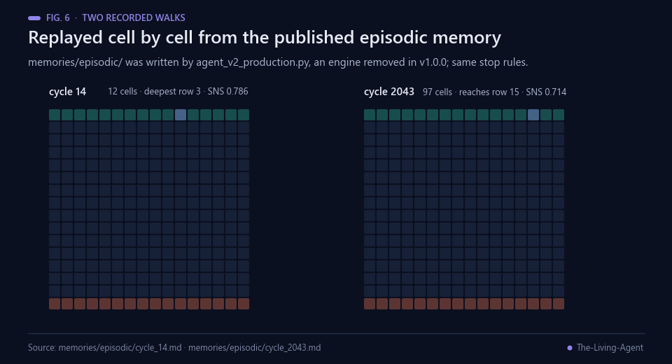<br><sub>Fig. 6 — Two recorded walks from memories/episodic/, written by the engine before v1.0.0.</sub></p>

<p align="center">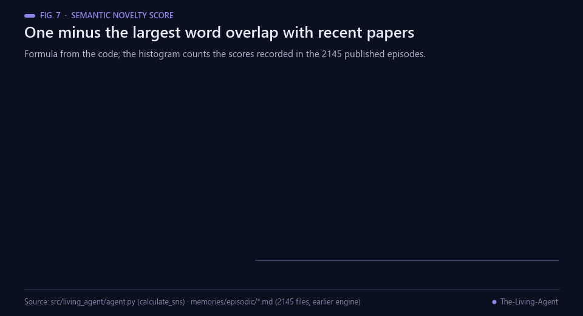<br><sub>Fig. 7 — The Semantic Novelty Score: formula from the code, scores from memories/episodic/.</sub></p>

---

## Background

<p align="center">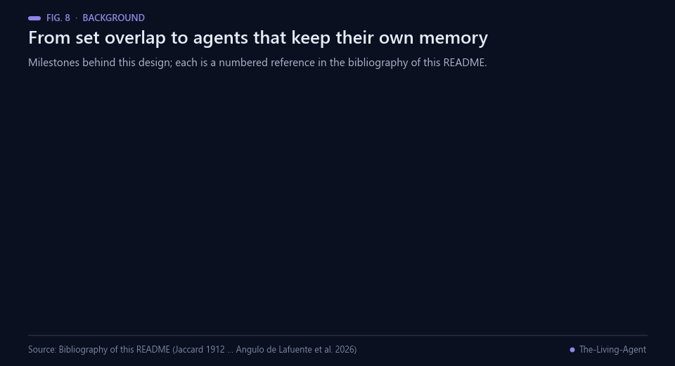<br><sub>Fig. 8 — Milestones behind this design. Sources: the bibliography below.</sub></p>

The novelty score is a set-overlap measure. Jaccard compared the flora of alpine districts by the share of species
two districts have in common out of all species found in either [[1](#ref-1)], and Broder later used the same ratio on
sets of word sequences to decide whether two web documents are near-duplicates [[2](#ref-2)]. `calculate_sns()` applies
it to single lower-case words against the last 50 papers on disk, so it measures lexical, not semantic, distance.
Rewarding difference rather than progress toward a fixed objective has its own line of work: novelty search showed
that searching only for new behaviours can beat objective-driven search on deceptive tasks [[5](#ref-5)].

Keeping the agent's world in documents rather than code echoes literate programming, in which a program is written
as an explanation addressed to people and the code is extracted from it [[3](#ref-3)]. The README credits Karpathy's
autoresearch, where a person programs an agent through a Markdown file while the agent edits and re-runs a training
script [[15](#ref-15)]. Classical cognitive architectures such as Soar organise problem solving into problem spaces and
learn new rules from experience [[4](#ref-4)]; CoALA maps language agents onto the same vocabulary of working,
episodic, semantic and procedural memory around a decision loop [[12](#ref-12)], which is close to how this repository
splits `soul.md`, `memories/episodic/`, `memories/semantic/` and `skills/`.

Among language agents, ReAct interleaves reasoning with actions that query an environment [[6](#ref-6)], Reflexion
stores verbal feedback in an episodic buffer and reuses it in later trials [[7](#ref-7)], generative agents keep a
natural-language memory stream that they retrieve and reflect on [[8](#ref-8)], and Voyager grows a library of
executable skills under an automatic curriculum [[9](#ref-9)]. Tree of Thoughts explores several reasoning branches
and backtracks [[10](#ref-10)]; the Chess-Grid instead commits to one link per step. Context limits matter for a walk
that accumulates every cell it reads: models use information in the middle of a long context worse than at its
ends [[11](#ref-11)], and MemGPT pages memory in and out of a fixed window [[13](#ref-13)]. The AI Scientist runs the research
loop end to end, from idea to a written and reviewed paper [[14](#ref-14)]. Here the model runs locally through
KoboldCpp, which serves GGUF models behind a KoboldAI-compatible API [[16](#ref-16)]. The repository belongs to the
author's P2PCLAW work, a decentralised platform in which agents publish, peer-review and score papers and whose
paper lists the Silicon Chess-Grid among its components [[17](#ref-17)].

## Python API

<p align="center">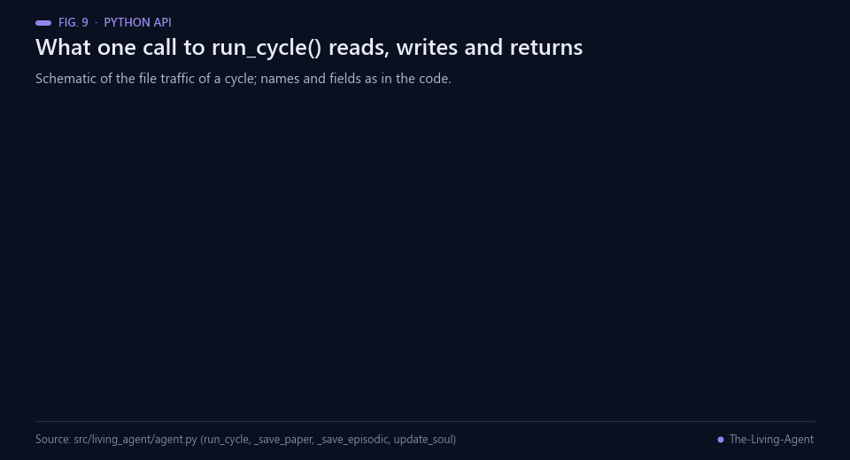<br><sub>Fig. 9 — What one run_cycle() call reads, writes and returns. Schematic, from src/living_agent/agent.py.</sub></p>

```python
from living_agent import LivingAgent, KoboldClient, generate_grid

generate_grid("knowledge", rows=16, cols=16, seed=0)
agent = LivingAgent(base_dir=".", client=KoboldClient("http://localhost:5001/api/v1/generate"))
result = agent.run_cycle()
print(result["cycle"], result["sns"], result["paper_bytes"])
```

---

## Honest limitations

<p align="center">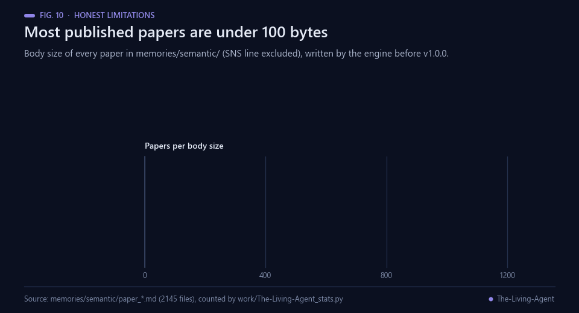<br><sub>Fig. 10 — Body size of the 2145 published papers, written by the engine before v1.0.0.</sub></p>

- **Paper output is short.** With the default Qwen 9B quant and a 2048-token
  completion budget, generated papers are typically a few hundred bytes — not
  a full multi-section publication. No post-processing is applied to inflate
  them.
- **Context window is bounded by the server.** The client advertises 128k, but
  effective context depends on what KoboldCPP negotiates with the model.
- **Synchronous only.** One cycle at a time; no asyncio, no batching, no
  multi-agent orchestration.
- **No automatic model download.** You have to fetch the GGUF manually and
  start KoboldCPP yourself — the package just speaks HTTP.
- **No network in tests.** The test suite mocks KoboldCPP with an in-process
  `http.server`; running the real agent still requires a live endpoint.

---

## Development

<p align="center">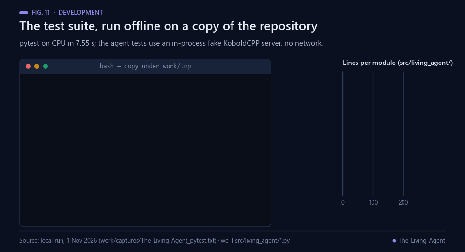<br><sub>Fig. 11 — The test suite run offline on a copy (27 passed in 7.55 s) and the size of each module.</sub></p>

```bash
pip install -e ".[dev]"
pytest                       # 23 tests
python -m build              # wheel + sdist into dist/
```

Layout:

```
src/living_agent/
    __init__.py      # version, re-exports
    grid.py          # 16x16 grid generator, cell topology
    llm_client.py    # KoboldCPP HTTP client
    agent.py         # reasoning loop, soul.md state, SNS scoring
    cli.py           # `living-agent {init,run,status}`
tests/
    test_grid.py     # 10 tests
    test_agent.py    # 8 tests (in-process fake HTTP server)
    test_cli.py      # 5 tests
```

---

## Real-world applications

<p align="center">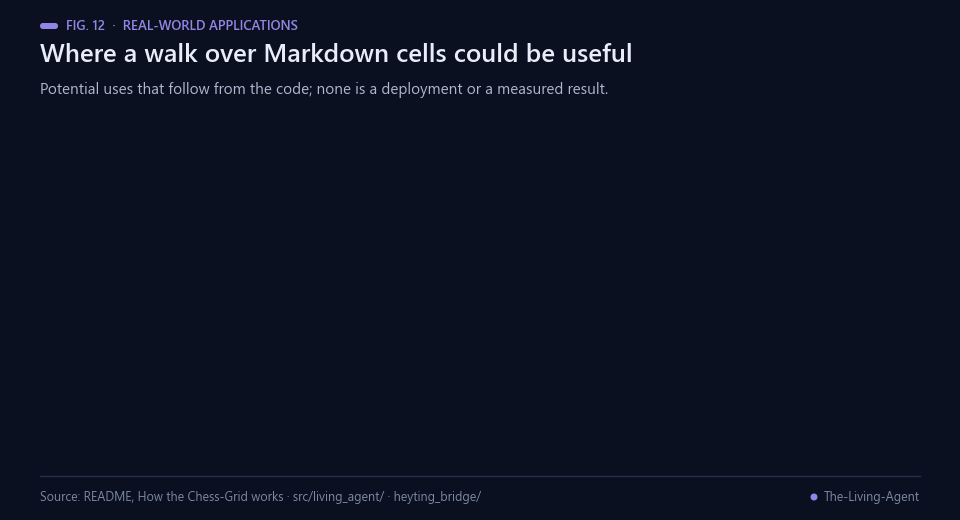<br><sub>Fig. 12 — Potential uses that follow from the code. None is a deployment or a measured result.</sub></p>

These are potential uses of the published code, not results.

- **Walks over your own notes.** Any folder of Markdown files that link to each other can play the role of the grid;
  the agent would chain neighbouring notes into a short synthesis.
- **Structured brainstorming.** Neighbouring cells hold unrelated research domains, so each move juxtaposes two
  topics, a cheap way to prompt cross-domain ideas.
- **A private, offline assistant.** Prompts go only to a local KoboldCpp server [[16](#ref-16)]; nothing leaves the
  machine.
- **Teaching agent design.** Five modules of about 650 lines and a mock-server test suite show a complete agent
  loop, from memory to tool call to persistence, that students can read in one sitting.
- **A testbed for novelty metrics.** The lexical score [[1](#ref-1), [2](#ref-2)] and the embedding variant in
  `heyting_bridge/living_agent_sns_embeddings.py` can be compared on the same papers.
- **Text-as-code knowledge bases.** Editing a cell file changes what the agent reads and which skills it acquires,
  without touching Python [[3](#ref-3), [15](#ref-15)].

## Possible improvements

<p align="center">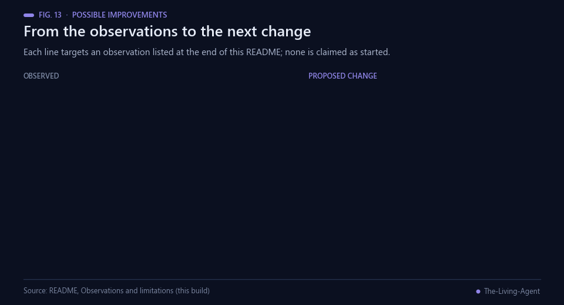<br><sub>Fig. 13 — Each line targets an observation listed in Observations and limitations. None is claimed as started.</sub></p>

- **Let papers run to length.** `synthesize()` calls `generate()` without a `stop_sequence`, so the default
  `["\n\n", "###"]` applies; a server that honours it ends the paper at its first blank line. A synthesis-specific
  stop list, and logging why generation stopped, would separate model limits from configuration.
- **Record why a walk ended.** The episode files store the trace and the score only. Writing the stop rule that
  fired (synthesis row, context budget, no links) would explain why 4 of 2145 recorded walks reach row 15.
- **Filter template output.** 162 published papers are empty and 436 contain template brackets such as `[Title]`.
  Rejecting or regenerating them before they enter the 50-paper window would keep the novelty score meaningful.
- **Align the Quickstart.** `living-agent init --grid-dir .` writes `./grid`, while `run` reads `knowledge/grid`;
  `--grid-dir knowledge` in the Quickstart, or one shared default, would make the three commands work in a fresh
  folder.
- **Parse the committed grid.** The link labels in `knowledge/grid/` contain nested brackets, for example
  `[satisfied [dependency]]` for the link to `cell_R2_C4.md`, and the pattern in `load_cell_links()` excludes `]` from a label, so it
  finds no link in any of the 256 committed cells. Accepting nested brackets, or writing plain labels, would let
  walks on that grid leave their entry cell.
- **Add a semantic score.** Word-set overlap counts a rephrased paper as novel. Reporting the embedding score from
  `heyting_bridge/` next to the Jaccard score [[2](#ref-2)] would show how far the two disagree.

## Future work

<p align="center">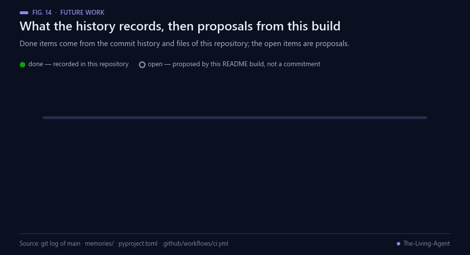<br><sub>Fig. 14 — Done items come from this repository's history; the open items are proposals from this README build.</sub></p>

Recorded in this repository:

1. Chess-Grid v3.0: the 16x16 board with eight-directional navigation (commit history, March 2026).
2. The Heyting bridge in `heyting_bridge/`: a verified knowledge grid and an embedding-based novelty score.
3. 2145 recorded cycles in `memories/` (April 2026).
4. The `living-agent` 1.0.0 package on PyPI, with the `init`, `run` and `status` commands (April 2026).
5. CI that runs the tests and builds the distribution on Python 3.10, 3.11 and 3.12 (September 2026).

The repository does not document a roadmap of its own.

**Proposed next steps (not commitments).** These are suggestions from this README build, not the author's
published plan: log the stop reason of every walk; let the synthesis call produce full-length papers and record
their length; filter empty and template papers out of the novelty window; report a semantic score next to the
lexical one; and fix the Quickstart grid path and the link parsing of the committed grid.

## Observations and limitations

<p align="center">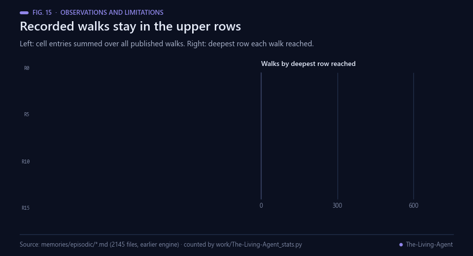<br><sub>Fig. 15 — Where the 2145 recorded walks went. Source: memories/episodic/, written by the engine before v1.0.0.</sub></p>

Found while building this README from the published files and from real runs; the original text above is unchanged.
The counts come from `memories/`, `soul.md` and `knowledge/grid/` on `main` and were written by `agent_v2_production.py`, the engine that wrote `memories/` and was removed in the v1.0.0 release commit
(`a2d81cb`). That engine used the same stop rules, the same 0.85 context ratio and the same novelty formula as
`src/living_agent/`, but the records are not output of v1.0.0.

- **Few walks reach the synthesis row.** Of 2145 recorded walks, 4 reach row 15 (cycles 2031, 2032, 2042 and 2043,
  with 214, 377, 259 and 97 cells). The median walk has 12 cells, the most common deepest row is row 2 (671 walks),
  and 207 of the 256 cells were ever entered. The episode files do not say which rule ended each walk.
- **Papers are shorter than the README states.** The README says papers are "typically a few hundred bytes". In
  `memories/semantic/` the median paper body is 71 bytes, 162 papers are empty and 436 contain template brackets
  such as `[Title]` or `[Your output here]`. The default stop sequence `"\n\n"`, which `synthesize()` does not
  override, may contribute: a paper can end at its first blank line.
- **The scores reward lexical change.** The recorded novelty scores have a median of 0.8 and 215 are 1.0; because
  they compare word sets, they do not show that the content is new.

<p align="center">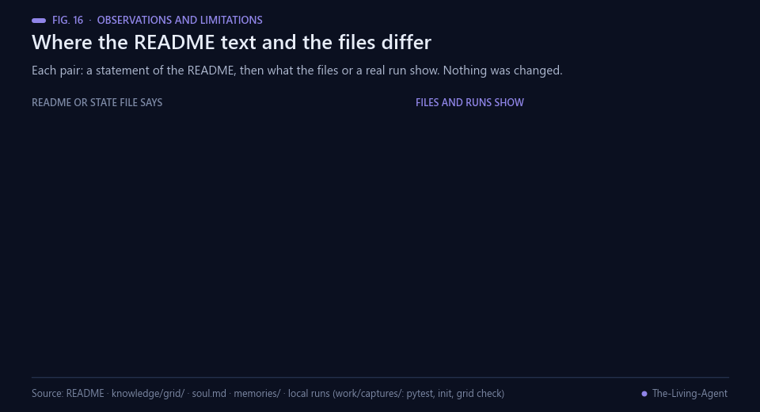<br><sub>Fig. 16 — README statements next to the files and real runs. Nothing in the repository was changed.</sub></p>

- **Quickstart grid path.** `living-agent init --grid-dir .` is commented as generating `knowledge/grid`; it writes
  `./grid` and `./grid_index.md`. In a fresh folder, `living-agent run` then stops with `FileNotFoundError` for
  `knowledge\grid\cell_R0_C5.md` (local run with the PyPI package, 1 Nov 2026). Inside a clone of this repository
  `run` reads the committed grid instead, and there the next point applies.
- **Walks on the committed grid end at once.** `load_cell_links()` finds no link in any of the 256 committed cells,
  because their link labels contain nested brackets (`[satisfied [dependency]]` for the link to `cell_R2_C4.md`). A run of the CLI
  on a copy of `knowledge/grid/`, with the mock endpoint, ended after its entry cell (`trace=1`). The 2145 recorded
  walks were made by the earlier engine, whose link pattern was the same, so they cannot come from the grid as it is
  committed today (unchanged since 12 Mar 2026); the repository does not record which grid they used.
- **Two grids.** The README describes a mutation chamber at the centre and occasional skill and experiment nodes.
  That is what `living-agent init` generates (1 mutation chamber, 13 skill nodes, 10 experiment nodes, Fig. 4).
  The committed `knowledge/grid/`, built from HeytingLean declarations by the Heyting bridge, has 16 ENTRY,
  224 KNOWLEDGE and 16 SYNTHESIS cells and none of the other three types.
- **Test count.** The README lists 23 tests (10 + 8 + 5). pytest collects and passes 27: `tests/test_agent.py` has
  9 test functions, one of which runs four parameter sets.
- **Counters.** `soul.md` reports `Current Cycle: 2141` and `Total Papers Published: 2140`, while `memories/` holds
  2145 episode files and 2145 paper files.
- **Not run here.** No figure uses a real LLM: the live run in Fig. 3 replaces KoboldCPP with a mock endpoint, as the
  test suite does, so its papers and scores say nothing about model quality.

## License & credits

Apache-2.0. Created by **Francisco Angulo de Lafuente** as the Silicon Layer
of [P2PCLAW](https://www.p2pclaw.com). Inspired by Karpathy's
[autoresearch](https://github.com/karpathy/autoresearch).

---

## Related projects

Part of the [@Agnuxo1](https://github.com/Agnuxo1) v1.0.0 open-source catalog (April 2026).

**AgentBoot constellation** — agents and research loops
- [AgentBoot](https://github.com/Agnuxo1/AgentBoot) — Conversational AI agent for bare-metal hardware detection and OS install.
- [autoresearch-nano](https://github.com/Agnuxo1/autoresearch) — nanoGPT-based autonomous ML research loop.
- [benchclaw-integrations](https://github.com/Agnuxo1/benchclaw-integrations) — Agent-framework adapters for the BenchClaw API.

**CHIMERA / neuromorphic constellation** — GPU-native scientific computing
- [NeuroCHIMERA](https://github.com/Agnuxo1/NeuroCHIMERA__GPU-Native_Neuromorphic_Consciousness) — GPU-native neuromorphic framework on OpenGL compute shaders.
- [Holographic-Reservoir](https://github.com/Agnuxo1/Holographic-Reservoir) — Reservoir computing with simulated ASIC backend.
- [ASIC-RAG-CHIMERA](https://github.com/Agnuxo1/ASIC-RAG-CHIMERA) — GPU simulation of a SHA-256 hash engine wired into a RAG pipeline.
- [QESN-MABe](https://github.com/Agnuxo1/QESN_MABe_V2_REPO) — Quantum-inspired Echo State Network on a 2D lattice (classical).
- [ARC2-CHIMERA](https://github.com/Agnuxo1/ARC2_CHIMERA) — Research PoC: OpenGL primitives for symbolic reasoning.
- [Quantum-GPS](https://github.com/Agnuxo1/Quantum-GPS-Unified-Navigation-System) — Quantum-inspired GPU navigator (classical Eikonal solver).

---

## 🧩 P2PCLAW Ecosystem

<p align="center">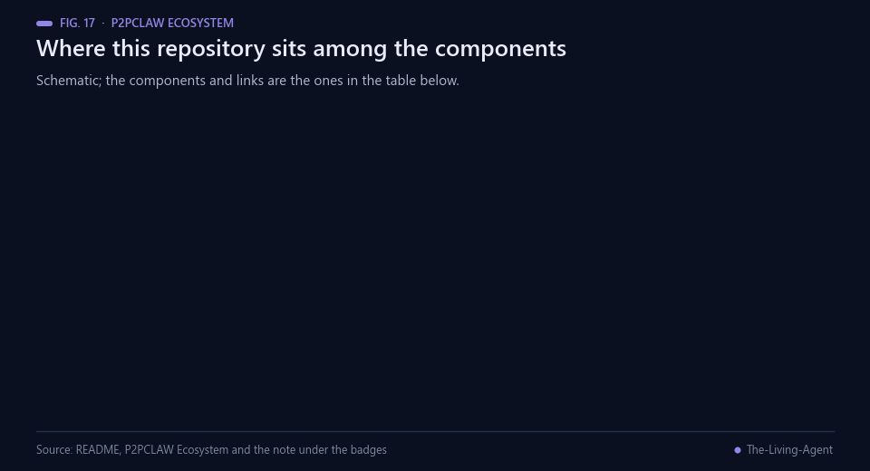<br><sub>Fig. 17 — Where this repository sits in P2PCLAW. Schematic.</sub></p>

This project is part of **P2PCLAW** — a distributed AI research network with production-grade benchmarking, agent tooling, and model distribution.

| Component | Role | Link |
|-----------|------|------|
| **OpenCLAW-P2P** | Core protocol · Lean 4 proofs · Papers | [github.com/Agnuxo1/OpenCLAW-P2P](https://github.com/Agnuxo1/OpenCLAW-P2P) |
| **BenchClaw** | 17-judge agent benchmarking | [github.com/Agnuxo1/benchclaw](https://github.com/Agnuxo1/benchclaw) |
| **EnigmAgent** | Local encrypted vault for credentials | [github.com/Agnuxo1/EnigmAgent](https://github.com/Agnuxo1/EnigmAgent) |
| **AgentBoot** | Bare-metal OS installer | [github.com/Agnuxo1/AgentBoot](https://github.com/Agnuxo1/AgentBoot) |
| **CAJAL** | 4B research LLM for papers | [huggingface.co/Agnuxo/CAJAL-4B-P2PCLAW](https://huggingface.co/Agnuxo/CAJAL-4B-P2PCLAW) |

🌐 **Main website:** [https://www.p2pclaw.com/](https://www.p2pclaw.com/)
📄 **Paper:** [arXiv:2604.19792](https://arxiv.org/abs/2604.19792)

---

## 💝 Support

If this tool is useful to you:
- ⭐ **Star the repo** — it's how the ecosystem discovers tools
- 🐛 **Open an issue** — every real use case sharpens the project
- 💰 **Sponsor:** [github.com/sponsors/Agnuxo1](https://github.com/sponsors/Agnuxo1)

Built by **Francisco Angulo de Lafuente** — independent researcher with 35+ years in software.

## Bibliography

1. <a id="ref-1"></a>Jaccard, P. (1912). The distribution of the flora in the alpine zone. *New Phytologist*, 11(2), 37–50. https://doi.org/10.1111/j.1469-8137.1912.tb05611.x
2. <a id="ref-2"></a>Broder, A. Z. (1997). On the resemblance and containment of documents. In *Proceedings of Compression and Complexity of SEQUENCES 1997*, 21–29. IEEE. https://doi.org/10.1109/SEQUEN.1997.666900
3. <a id="ref-3"></a>Knuth, D. E. (1984). Literate Programming. *The Computer Journal*, 27(2), 97–111. https://doi.org/10.1093/comjnl/27.2.97
4. <a id="ref-4"></a>Laird, J. E., Newell, A., & Rosenbloom, P. S. (1987). SOAR: An architecture for general intelligence. *Artificial Intelligence*, 33(1), 1–64. https://doi.org/10.1016/0004-3702(87)90050-6
5. <a id="ref-5"></a>Lehman, J., & Stanley, K. O. (2011). Abandoning Objectives: Evolution Through the Search for Novelty Alone. *Evolutionary Computation*, 19(2), 189–223. https://doi.org/10.1162/EVCO_a_00025
6. <a id="ref-6"></a>Yao, S., Zhao, J., Yu, D., et al. (2022). ReAct: Synergizing Reasoning and Acting in Language Models. *arXiv* 2210.03629. https://arxiv.org/abs/2210.03629
7. <a id="ref-7"></a>Shinn, N., Cassano, F., Berman, E., et al. (2023). Reflexion: Language Agents with Verbal Reinforcement Learning. *arXiv* 2303.11366. https://arxiv.org/abs/2303.11366
8. <a id="ref-8"></a>Park, J. S., O'Brien, J. C., Cai, C. J., et al. (2023). Generative Agents: Interactive Simulacra of Human Behavior. *arXiv* 2304.03442. https://arxiv.org/abs/2304.03442
9. <a id="ref-9"></a>Wang, G., Xie, Y., Jiang, Y., et al. (2023). Voyager: An Open-Ended Embodied Agent with Large Language Models. *arXiv* 2305.16291. https://arxiv.org/abs/2305.16291
10. <a id="ref-10"></a>Yao, S., Yu, D., Zhao, J., et al. (2023). Tree of Thoughts: Deliberate Problem Solving with Large Language Models. *arXiv* 2305.10601. https://arxiv.org/abs/2305.10601
11. <a id="ref-11"></a>Liu, N. F., Lin, K., Hewitt, J., et al. (2023). Lost in the Middle: How Language Models Use Long Contexts. *arXiv* 2307.03172. https://arxiv.org/abs/2307.03172
12. <a id="ref-12"></a>Sumers, T. R., Yao, S., Narasimhan, K., & Griffiths, T. L. (2023). Cognitive Architectures for Language Agents. *arXiv* 2309.02427. https://arxiv.org/abs/2309.02427
13. <a id="ref-13"></a>Packer, C., Wooders, S., Lin, K., et al. (2023). MemGPT: Towards LLMs as Operating Systems. *arXiv* 2310.08560. https://arxiv.org/abs/2310.08560
14. <a id="ref-14"></a>Lu, C., Lu, C., Lange, R. T., et al. (2024). The AI Scientist: Towards Fully Automated Open-Ended Scientific Discovery. *arXiv* 2408.06292. https://arxiv.org/abs/2408.06292
15. <a id="ref-15"></a>Karpathy, A. (2026). *autoresearch* [Software repository]. GitHub. https://github.com/karpathy/autoresearch
16. <a id="ref-16"></a>LostRuins and contributors. (2023–2026). *KoboldCpp* [Software repository]. GitHub. https://github.com/LostRuins/koboldcpp
17. <a id="ref-17"></a>Angulo de Lafuente, F., Sharma, T., Veselov, V., et al. (2026). OpenCLAW-P2P v7.0-P2PCLAW: Resilient multi-layer persistence, live reference verification, and production-scale evaluation of decentralized AI peer review. *arXiv* 2604.19792. https://arxiv.org/abs/2604.19792

---

<div align="center">
<sub>Animated figures added for the P2PCLAW portfolio · every number in them comes from a file of this repository
or from the real offline run named in the figure footer ·
<a href="#the-living-agent">back to top ↑</a></sub>
</div>
